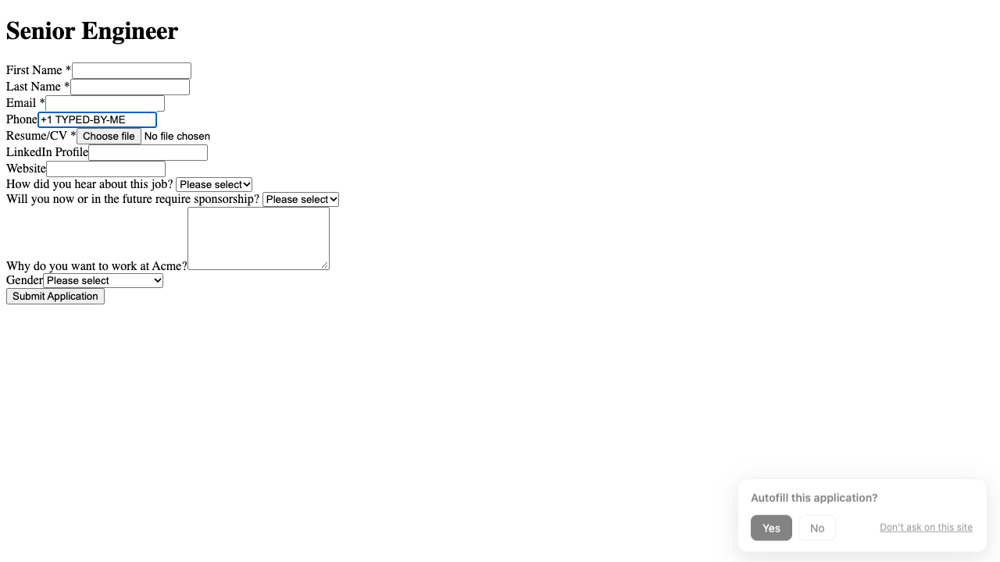
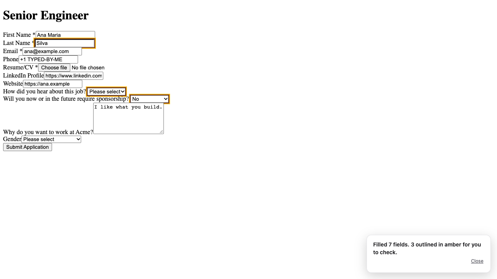
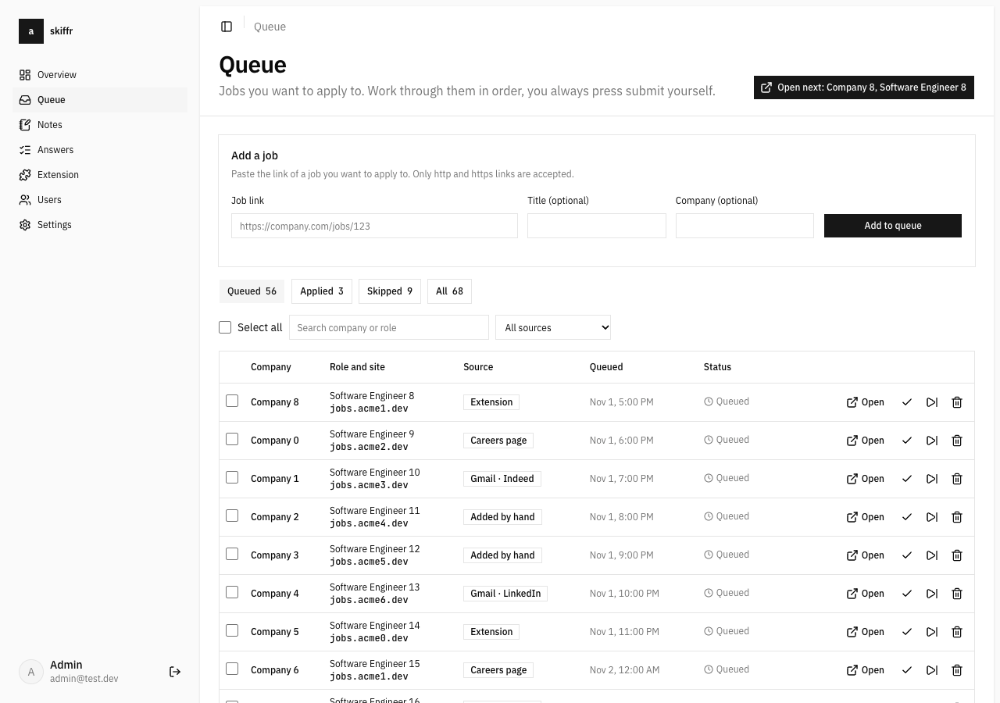
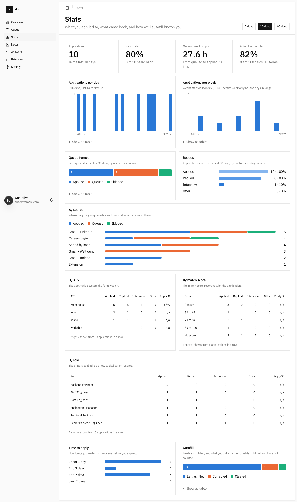
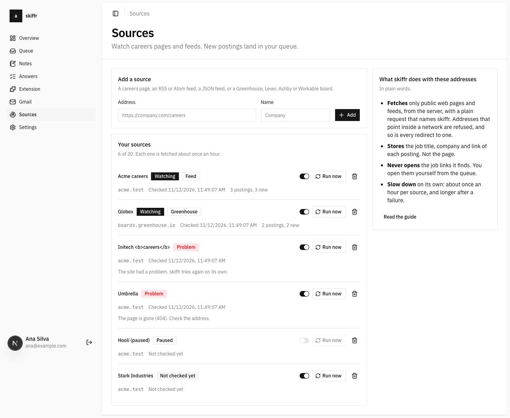
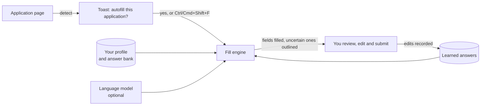

<p align="center">
  <picture>
    <source media="(prefers-color-scheme: dark)" srcset="https://shieldcn.dev/header/grid.svg?title=skiffr&subtitle=Job+application+autofill+that+learns.+Open+source%2C+self-hosted.&align=left&mode=dark" />
    
  </picture>
</p>

<p align="center">
  <a href="https://github.com/FindMalek/skiffr/actions/workflows/ci.yml"></a>
  <a href="https://github.com/FindMalek/skiffr/blob/main/LICENSE"></a>
  <a href="https://github.com/FindMalek/skiffr/stargazers"></a>
</p>

skiffr is an open-source Chrome extension for job applications. It spots an application form, asks, fills it from your own profile and answer bank, and never submits anything for you. A dashboard keeps your profile, answers and a queue of jobs to apply to. You host the api and the database yourself: your profile, answers, queue and tokens live in your own Postgres, and only a small listed slice goes to a model provider, and only if you set a key.

> **Early development.** There is no release and no Chrome Web Store listing yet: you build the extension or load a CI build by hand (see [quick start](#quick-start)). The extension learns from your edits, with the limits listed under [how it works](#how-it-works).

<p align="center">
  
  
</p>
<p align="center">
  
  
  
</p>

## What it does

**In the browser (the extension)**

- Detects an application form (Greenhouse, Lever, Ashby, Workable, Workday and others, also inside iframes) and shows a small toast: yes, no, or "don't ask on this site". `Ctrl+Shift+F` (`Cmd+Shift+F` on macOS) fills the current page without the toast.
- Fills the form the way a person types, so React and Vue forms accept it: inputs, selects, comboboxes, checkboxes, radios, shadow DOM, same-origin iframes. Honeypots are skipped.
- Answers each field from the best source it has: what you filled on this very form before, then a saved answer for the same question, then a language model that maps the field to a key of your profile. Fields the model is unsure about are filled and outlined in amber for you to check.
- Learns from your edits: after a skiffr fill it records what you corrected, cleared or left as filled, so the next form starts from your answers. Sensitive fields are never recorded.
- Never submits a form, never clicks submit, next or apply, never touches password or hidden inputs.

**In the dashboard**

- **Profile and answer bank.** Edit your profile and your saved answers, with use and correction counts and keep or drop suggestions.
- **Queue.** Jobs you want to apply to, with source, status and an "Open next" flow. You press submit yourself.
- **Gmail connector.** Turns LinkedIn, Indeed and Glassdoor job alert emails into queued jobs. It asks for the `gmail.modify` scope because it also marks processed mail read, takes it out of the inbox and adds a `skiffr/jobs` label. It never deletes or sends mail. [Docs](apps/docs/content/docs/gmail.mdx)
- **Source watcher.** Watches careers pages, RSS or Atom feeds and Greenhouse, Lever, Ashby or Workable boards, and queues new postings. [Docs](apps/docs/content/docs/sources.mdx)
- **Stats.** Applications per day and week, queue funnel, replies, by source, ATS, role and match score, and how well autofill knows you.
- **Extension tokens.** Create and revoke the personal tokens the extension uses.

**On the api**

- A learning api: a correction log, answer lookup (exact fingerprint, then normalized label, then embedding similarity as a suggestion only) and keep or drop suggestions. See [how skiffr learns](apps/docs/content/docs/learning.mdx).

### What needs keys

Everything works without these except the parts that name them. All are optional.

| Key | Needed for | Without it |
| --- | --- | --- |
| `GROQ_API_KEY` ([Groq](https://console.groq.com/keys)) | mapping fields the saved answers do not cover, which can also return a short generated value such as a yes or no or an option pick, shown outlined for you to check (default model `openai/gpt-oss-120b`). The api can also draft answers, but the extension does not call that yet | the ai endpoints say no provider key is configured. Profile, answers, queue and saved-answer fills keep working |
| `OPENAI_API_KEY` ([OpenAI](https://platform.openai.com/api-keys)) | embedding similarity for learned answers | similar-question suggestions are skipped, exact and label matches still work |
| `GOOGLE_CLIENT_ID`, `GOOGLE_CLIENT_SECRET`, `GMAIL_ENCRYPTION_KEY` ([Google Cloud](https://console.cloud.google.com/)) | the Gmail connector | the Gmail page says it is not set up. Setup is in the [Gmail docs](apps/docs/content/docs/gmail.mdx), and it has only been tested against a local stand-in for Google's api |

`AI_MODEL` can also point at `openai:` or `anthropic:` models with the matching key. Every key is listed in the [environment docs](apps/docs/content/docs/environment.mdx). The source watcher needs no keys.

## How it works



Learning from your edits closes this loop: the edit is logged as a correction and the better answer is used first next time. Limits of the learning step today:

- It only records after a skiffr fill, and fields that already had a value at fill time are not recorded.
- It sends when you submit the form, when you leave the page or the tab goes to the background, or after 5 minutes without an edit, at most 3 batches per session. A hidden tab cannot send, so closing a background tab or quitting the browser loses that batch.
- Forms with more than 60 learnable fields only record the first 60.
- Sensitive fields and values are filtered in the content script and again in the worker, so they never reach your api.
- Cross-origin iframes are not recorded yet.

## Architecture

```text
skiffr/
├─ apps/
│  ├─ web/         landing page, Next.js
│  ├─ dashboard/   Next.js, better-auth: profile, answers, queue, stats, Gmail, sources, tokens
│  ├─ api/         oRPC on bun, the only app that touches Postgres
│  ├─ extension/   WXT, React, Manifest V3
│  ├─ e2e/         Playwright suite for the extension
│  └─ docs/        fumadocs
├─ packages/
│  ├─ ai/          Vercel AI SDK: field mapping, answer drafts
│  ├─ orpc/        procedures and typed clients
│  ├─ db/          Drizzle schema, migrations, pgvector
│  ├─ common/      zod schemas, constants, utils shared everywhere
│  ├─ auth/        better-auth setup
│  ├─ env/         zod-validated env, one root .env
│  ├─ storage/     S3 compatible storage
│  ├─ ui/          shadcn components, monochrome preset
│  └─ config/      shared tsconfig
├─ docker/         local Postgres with pgvector
└─ turbo.json
```

`apps/api` is the only app that touches the database, auth and model providers. The dashboard and the extension call it through `@skiffr/orpc`. The extension authenticates with a personal access token (`skp_...`), stored hashed on the server, and can only call a short allowlist of procedures. More in [structure](apps/docs/content/docs/structure.mdx).

## Quick start

You need node 24, pnpm, bun and docker.

```bash
pnpm install
cp .env.example .env     # then set BETTER_AUTH_SECRET and ADMIN_PASSWORD
pnpm db:up               # Postgres with pgvector on :5432
pnpm dev --filter='!extension'
```

`BETTER_AUTH_SECRET` must be at least 32 characters (`openssl rand -base64 32`) or the api refuses to start. `ADMIN_PASSWORD` must be at least 10 characters. `DATABASE_URL` already matches the local Postgres from `pnpm db:up`.

| App | Url |
| --- | --- |
| `apps/web` | http://localhost:3000 |
| `apps/api` | http://localhost:3001 |
| `apps/dashboard` | http://localhost:3002 |
| `apps/docs` | http://localhost:3003 |

Sign in to the dashboard with `ADMIN_EMAIL` and `ADMIN_PASSWORD`, save your profile, and create a token on the Extension page. `pnpm dev` without the filter also starts the extension dev server (`wxt`), which opens a development browser with hot reload.

### Install the extension

It needs Chrome 142 or newer (the token isolation below is the reason), or a Chromium browser of the same age.

```bash
pnpm --filter extension build
```

Open `chrome://extensions`, turn on developer mode, choose "Load unpacked" and pick `apps/extension/.output/chrome-mv3`. In the extension options set the api url (`http://localhost:3001`), paste your token and press test connection. Then open an application form and answer the toast.

Or take a CI build: every pull request uploads `extension-chrome-pr-<number>` and every push to `main` uploads `extension-chrome-latest` on the [CI runs](https://github.com/FindMalek/skiffr/actions/workflows/ci.yml) (GitHub login required, artifacts expire). Unzip the download, extract the inner `extension-<version>-chrome.zip` into an empty folder and load that folder unpacked. More in the [setup docs](apps/docs/content/docs/setup.mdx).

### Commands

| Command | What it does |
| --- | --- |
| `pnpm dev` | every workspace with a `dev` script, extension included |
| `pnpm build` | build everything with turbo |
| `pnpm lint` | `biome ci . && oxlint` |
| `pnpm check` | biome format and fix |
| `pnpm check-types` | typescript across the repo |
| `pnpm test` | tests in every package |
| `pnpm e2e` | build the extension and run the Playwright suite in `apps/e2e` |
| `pnpm db:generate` / `db:migrate` / `db:seed` / `db:studio` | drizzle |
| `pnpm zip` | zip the extension |
| `pnpm ui:add <component>` | add a shadcn component |

Router tests run on pglite. To use real Postgres set `TEST_DATABASE_URL` to a server url whose database name starts with `skiffr_test`.

## Self-hosting

skiffr runs on your own server: the api, the Next apps and a Postgres with the `vector` extension, one Dockerfile per app. The [deploy guide](apps/docs/content/docs/deploy.mdx) covers Docker, Vercel and Dokploy, including the pgvector image and why you must not swap an existing database image in place. The `deploy` workflow builds the images on every green push to `main` and redeploys Dokploy, and `scripts/dokploy-bootstrap.mjs` sets a Dokploy project up in one go. Nothing deploys until the repo variable `DEPLOY_ENABLED` is `true`.

## Security and privacy

- **Your profile, answers, queue and tokens live in your own Postgres.** The extension has no analytics and is built to talk only to the api you configured. Only the slice below goes to a model provider, and only if you set a key.
- **The token is only readable by the extension's background worker and options page.** Content scripts on web pages are kept from it by `storage.local.setAccessLevel("TRUSTED_CONTEXTS")`, which is why the manifest needs Chrome 142. The server stores a SHA-256 hash. A token can only call a fixed list of procedures, account and token management need a signed-in session.
- **The model sees a small slice.** Field descriptors, your profile key names, and values for a short allowlist (name, city, links, skills). Email, phone, address, pay and ids are never sent. Password, hidden and file inputs are dropped first, and page text is treated as untrusted data in the prompt. Drafting an answer through the api also sends the question, the job description and up to 5 of your earlier answers. Leave the provider keys unset and nothing is sent.
- **Sensitive fields are not learned.** Secrets, card and bank data, government and tax ids, birth dates and equal opportunity categories are skipped, and so are values that look like a card number, an IBAN or a US social security number.
- **The source watcher only fetches public web pages.** It refuses private, loopback, link-local and cloud metadata addresses (SSRF guard), resolves the name itself and connects to the address it checked, re-checks every redirect, and bounds size and time. Details in the [job sources docs](apps/docs/content/docs/sources.mdx).
- **Gmail refresh tokens are encrypted at rest** (AES-256-GCM). skiffr stores job title, company and link, not the email, and it needs a signed-in browser session, an extension token cannot call it.

The longer version is in [privacy and data flow](apps/docs/content/docs/privacy.mdx). Report vulnerabilities privately through GitHub (Security tab, "Report a vulnerability"), not in a public issue. See [SECURITY.md](SECURITY.md).

## Contributing

Read [CONTRIBUTING.md](CONTRIBUTING.md). In short:

- Work is tracked as issues on the [project board](https://github.com/users/FindMalek/projects/25). One issue per pull request, with `closes #<n>` in the body. A branch named `type/<n>-slug` gets the link added for you.
- Commits are `type(scope): subject`, subject at most 5 words, for example `fix(extension): select combobox`.
- Pull requests are squash merged only, so the PR title follows the same format.
- The required `ci` check must be green: lint, types, tests, build, extension zip and router tests on real Postgres.
- UI changes need a screenshot, pushed to the orphan `pr-screenshots` branch as `<pr-number>/<name>.png`, never into a feature branch.

Everyone is expected to follow the [code of conduct](CODE_OF_CONDUCT.md).

## Roadmap

The board has the full list: [github.com/users/FindMalek/projects/25](https://github.com/users/FindMalek/projects/25). What is next:

- ATS adapters for Greenhouse, Lever, Ashby and Workable ([#6](https://github.com/FindMalek/skiffr/issues/6))
- Learned HTTP replay recipes ([#18](https://github.com/FindMalek/skiffr/issues/18))
- CV tailoring through Reactive Resume, as edits that never invent facts ([#17](https://github.com/FindMalek/skiffr/issues/17))
- A Chrome Web Store listing ([#26](https://github.com/FindMalek/skiffr/issues/26))

## License

[MIT](LICENSE), copyright (c) 2026 FindMalek.
